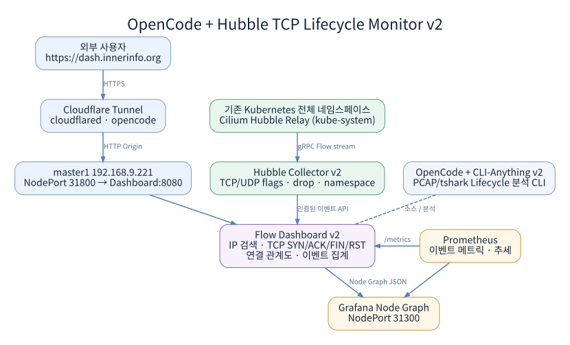
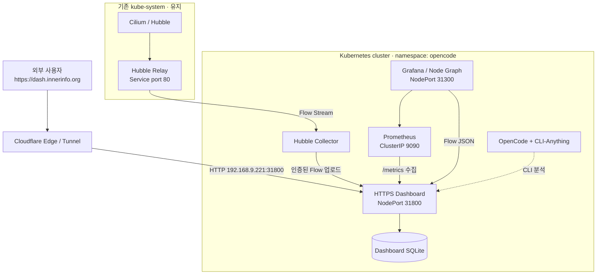
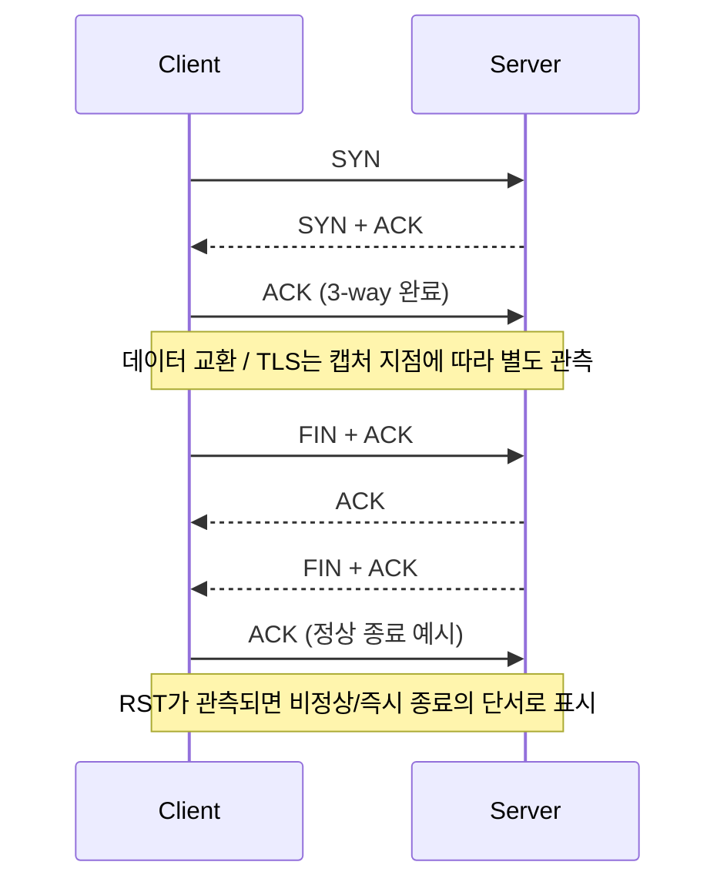

# OpenCode Hubble TCP Lifecycle Monitor v2

> **Kubernetes 네트워크 흐름 모니터링 · IP별 TCP 연결 수명주기 분석 · Grafana/Prometheus · OpenCode/CLI-Anything**
>
> `opencode` 네임스페이스의 독립 설치본입니다. 기존 Cilium/Hubble 인프라는 재사용하며, Draw.io는 사용하지 않습니다.

## 1. 프로젝트 개요

**OpenCode Hubble TCP Lifecycle Monitor v2**는 Kubernetes의 Cilium Hubble 흐름 이벤트를 수집하여 네임스페이스·IP·포트별 통신 관계를 시각화하고, 특정 TCP 연결에서 **SYN, SYN/ACK, ACK, FIN, RST 및 정책 Drop** 등이 관측된 시점을 확인하는 모니터링 환경입니다.

- **Hubble Collector**: 클러스터 전체 네임스페이스의 TCP/UDP Flow를 Hubble Relay에서 수집
- **HTTPS Dashboard**: 네트워크 흐름, 시간별 통계, 특정 IP 검색, TCP 연결별 관측 이벤트 및 진단 단서
- **Prometheus + Grafana**: 메트릭 저장·조회, 추세 및 Node Graph 관계도
- **OpenCode + CLI-Anything**: CLI 기반 프로젝트 관리 및 PCAP 분석 작업 자동화
- **Cloudflare Tunnel**: 외부 `https://dash.innerinfo.org`를 내부 Dashboard로 전달

> **관측 범위:** Hubble Flow는 전체 패킷 캡처 또는 실시간 활성 TCP 세션 목록과 같지 않습니다. 관측되지 않은 SYN/ACK/FIN을 장애로 단정하지 않으며, 정확한 재전송/SEQ·ACK/TLS 협상 분석에는 실제 PCAP이 필요합니다.

## 2. 전체 구성도





- Cloudflare Tunnel의 **외부 접속은 HTTPS**, Dashboard로 향하는 **Origin은 HTTP**입니다.
- Grafana는 내부 노드 접속용 `31300`이며, 별도의 외부 도메인은 이 패키지에서 설정하지 않습니다.
- 기존 Cilium/Hubble은 설치·초기화 대상에 포함하지 않습니다.

## 3. 기준 환경 및 접속 정보

| 구분 | 설정값 |
|---|---|
| Kubernetes | v1.36.x / containerd (기준 설치 환경) |
| 운영체제 | Rocky Linux 9.8 |
| 설치 기준 노드 | `master1` / `192.168.9.221` |
| 워커 노드 | `worker1` ~ `worker3` |
| 네임스페이스 | `opencode` |
| 실제 운영 디렉터리 | `/opt/opencode` |
| 재설치 원본 보관 | `/root/opencode-v2` |
| 백업 보관 | `/root/opencode-backups` |
| 작업 디렉터리 | `/home/toss` (초기화 시 보존) |
| Dashboard | [https://dash.innerinfo.org](https://dash.innerinfo.org) |
| Dashboard NodePort | `http://192.168.9.221:31800` |
| Grafana NodePort | `http://192.168.9.221:31300` |
| Prometheus | `lifecycle-prometheus.opencode.svc.cluster.local:9090` |
| Hubble Relay | `hubble-relay.kube-system.svc.cluster.local:80` (실제 Service 포트 자동 확인) |
| Cloudflare Origin | `http://192.168.9.221:31800` |
| GitHub | [yblmmen/opencode](https://github.com/yblmmen/opencode) · `main` |

## 4. 디렉터리 구성

```text
/opt/opencode/
├── CLI-Anything/               # OpenCode 연결용 CLI-Anything 소스
├── Dockerfile*                 # OpenCode, Collector, Dashboard, Grafana 이미지
├── VERSION
├── collector/                  # Hubble Flow Collector
├── dashboard/                  # 웹 UI, TCP 검색 API, SQLite 연동
├── grafana/                    # Grafana 대시보드 정의
├── k8s/                        # Namespace, Deployment, Service, ConfigMap
├── scripts/                    # 설치, 초기화, 점검, GitHub 업로드, TCP 분석
├── docs/                       # 상세 매뉴얼 및 구성도
├── tests/                      # Python 테스트
├── config/                     # OpenCode 설정 및 CLI 명령어
├── secrets/                    # 운영 인증정보
├── data/                       # OpenCode 세션 데이터
├── dashboard-data/             # Dashboard SQLite 데이터
├── grafana-data/               # Grafana 운영 데이터
└── prometheus-data/            # Prometheus 운영 데이터
```

## 5. 설치 전 준비

`master1`에서 `root`로 실행합니다. **기존 Cilium/Hubble은 정상 운영 중**이어야 합니다.

```bash
kubectl get nodes -o wide
kubectl -n kube-system get svc hubble-relay
kubectl get svc -A | grep -E '31800|31300' || true
for cmd in git docker ctr kubectl openssl curl python3 unzip; do command -v "$cmd" || echo "MISSING: $cmd"; done
```

**필요 조건**

1. `kubectl`, Docker 이미지 빌드 환경, containerd의 `ctr`, Git, Python, curl, unzip 등 설치
2. 이미지 다운로드를 위한 GitHub/GHCR/Docker Hub 접근
3. Ollama API Key, Cloudflare Tunnel Token 준비 (설치 시 입력)
4. `master1` 노드 이름 및 HostPath 데이터 디렉터리 사용 가능
5. NodePort `31800`, `31300` 미사용 확인

## 6. 완전 신규 설치 및 재설치

설치 패키지 `opencode-hubble-v2-final.zip`을 **`/root/`에 복사**합니다.

### 6-1. 기존 v1/v1.1/v2 전체 초기화 후 재설치

> **주의:** 이 작업은 `opencode` 네임스페이스 **전체**와 `/opt/opencode`를 삭제합니다. 별도로 설치한 다른 리소스가 해당 네임스페이스에 있으면 함께 삭제됩니다. 기존 데이터를 백업한 뒤 진행합니다.

```bash
cd /root
unzip -oq opencode-hubble-v2-final.zip -d /root
bash /root/opencode-v2/scripts/reinstall.sh
```

- 삭제 확인 문구: `DELETE OPENCODE V2`
- 실행 순서: Pod 쓰기 중단 → `/opt/opencode` 전체 백업 → `opencode` 네임스페이스 삭제 → 운영 디렉터리 교체 → 새 이미지 빌드 및 배포 → Cloudflare 설치 → 점검
- **보존 대상:** `/home/toss`, `/root/opencode-v2`, 기존 `kube-system`의 Cilium/Hubble, Cloudflare 관리 화면의 DNS/Route, GitHub 원격 저장소
- 기존 통계·세션 DB는 자동 복원하지 않으며, 백업 파일에 보관됩니다.

### 6-2. 설치 이력이 없는 신규 서버

```bash
cd /root
unzip -oq opencode-hubble-v2-final.zip -d /root
bash /root/opencode-v2/scripts/fresh-install.sh
```

### 6-3. 초기화만 수행

```bash
bash /root/opencode-v2/scripts/reset.sh
```

초기화 후 신규 설치는 `bash /root/opencode-v2/scripts/fresh-install.sh`를 실행합니다. **초기화 스크립트는 `/opt/opencode`가 아닌 `/root/opencode-v2`의 파일을 사용하십시오.**

## 7. 외부 접속 — Cloudflare Tunnel

Cloudflare Zero Trust의 해당 Tunnel에서 Published Application 경로를 아래와 같이 유지합니다.

| 항목 | 값 |
|---|---|
| Public hostname | `dash.innerinfo.org` |
| Service type | `HTTP` |
| Origin service URL | `http://192.168.9.221:31800` |
| 외부 브라우저 | `https://dash.innerinfo.org` |

터널은 `opencode` 네임스페이스의 `cloudflared` Deployment로 실행됩니다. NodePort는 Kubernetes Service를 통해 Dashboard Pod(8080)로 연결됩니다.

## 8. 설치 완료 점검

```bash
cd /opt/opencode
kubectl -n opencode get pods,deploy,svc -o wide
bash scripts/check.sh
kubectl -n opencode logs deploy/hubble-collector --tail=50
```

API 직접 점검:

```bash
curl -sS 'http://192.168.9.221:31800/api/summary?minutes=5'
curl -sS 'http://192.168.9.221:31300/api/health'
```

**정상 확인 기준**: Pod `Running` 외에도 Collector의 Relay 연결·업로드 로그, Dashboard의 Collector 연결 상태 및 실시간 이벤트 수 증가가 확인되어야 합니다.

## 9. 주요 기능 사용법

### 9-1. 네트워크 흐름 대시보드

[https://dash.innerinfo.org](https://dash.innerinfo.org)에서 네임스페이스별 흐름, IP별 연결, 포트, 최근 이벤트, 차단·오류 상태 및 발생 추이를 조회합니다.

### 9-2. IP별 TCP Lifecycle 분석

1. **IP별 TCP 연결 수명주기**에서 검색할 IP 입력
2. 필요 시 상대 IP, 포트, 조회 기간 지정
3. `출발지 IP:Port ↔ 목적지 IP:Port` 연결 목록에서 선택
4. Hubble에 관측된 SYN, SYN/ACK, ACK, PSH, FIN, RST, Drop을 시간순으로 확인
5. 이벤트 방향, 관측 노드, Drop 사유를 근거로 장애 구간 분석

CLI 검색 예시:

```bash
bash /opt/opencode/scripts/test-tcp.sh 10.0.0.219
```

아래는 **TCP의 개념적인 정상 연결·종료 과정**입니다. 실제 UI에는 Hubble에서 관측된 이벤트만 표시됩니다.



**진단 해석**

| 관측 현상 | 가능한 진단 단서 |
|---|---|
| SYN 반복 / SYN-ACK 미관측 | 상대 응답 부재, 필터링, 관측 누락 가능성 구분 필요 |
| `DROPPED` | 정책 차단 사유와 관측 지점 확인 |
| Server → Client RST | 서버 측에서 RST 전송 관측; 앱/리스너 로그와 대조 |
| Client → Server RST | 클라이언트 측 RST 전송 관측; 클라이언트 로그 확인 |
| 양방향 FIN + ACK | 정상 종료 관련 단계 관측, SEQ/ACK 최종 검증은 별도 필요 |

### 9-3. PCAP 기반 상세 TCP/TLS 분석

패킷 캡처 파일이 있을 때만 tshark 기반 분석기를 사용합니다.

```bash
bash /opt/opencode/scripts/https-lifecycle.sh \
  /home/toss/captures/session.pcapng 0 \
  --out /home/toss/captures/session.html
```

외부 `dash.innerinfo.org`의 HTTPS는 Cloudflare에서 종료됩니다. **클러스터 내부 NodePort HTTP 패킷을 분석해도 외부 TLS ClientHello/ServerHello를 복원할 수 없습니다.** TLS가 실제 관측되는 구간에서 별도 PCAP이 필요합니다.

### 9-4. Grafana / Prometheus

- Grafana: `http://192.168.9.221:31300` (로그인 ID: `admin`)
- Grafana 관리자 비밀번호 확인: `cat /opt/opencode/secrets/grafana_admin_password`
- Prometheus: ClusterIP `9090`; Grafana의 데이터 소스로 사용

### 9-5. OpenCode / CLI-Anything

```bash
kubectl -n opencode exec -it deploy/opencode -- opencode
```

OpenCode에서 `/cli-anything-list`와 `/https-lifecycle` 명령을 사용할 수 있습니다. AI 모델 API 접속 상태와 Hubble 수집기는 별도의 구성 요소입니다.

## 10. 운영 및 장애 점검

```bash
kubectl -n opencode get pods,deploy,svc
kubectl -n opencode logs deploy/hubble-collector --since=5m
kubectl -n opencode logs deploy/https-dashboard --tail=60
kubectl -n opencode logs deploy/cloudflared --tail=40
bash /opt/opencode/scripts/check.sh
```

| 증상 | 우선 확인 |
|---|---|
| Dashboard Flow 0건 | Collector 로그, Hubble Relay 연결 및 업로드 상태 |
| Collector HTTP 401 | `dashboard-ingest` Secret, Collector/Dashboard 토큰 일치 여부 |
| Grafana 31300 접속 안 됨 | Grafana Service NodePort·Pod 상태·방화벽 |
| 외부 주소만 접속 안 됨 | Cloudflare Route/DNS, Tunnel 연결, Origin NodePort |
| SYN/FIN 단계 일부 누락 | Hubble 미관측 여부, 캡처 위치, PCAP 분석 필요성 |
| `ImagePullBackOff` | master1의 이미지 빌드·containerd import 상태 |

**수집 필터:** 기본값은 전체 네임스페이스, 전체 TCP/UDP 포트입니다. 변경이 필요한 경우 `opencode-runtime-settings` ConfigMap의 `FILTER_PORTS`, `FILTER_NAMESPACES`를 수정하고 Collector Deployment를 재시작합니다.

## 11. GitHub 저장소 업데이트

이미 GitHub가 연결된 `/opt/opencode`에서 **README 파일만 변경**하려면:

```bash
cd /opt/opencode
git add README.md
git commit -m "docs: update OpenCode Hubble v2 README"
git push origin main
```

- GitHub 저장소: [https://github.com/yblmmen/opencode](https://github.com/yblmmen/opencode)
- 위 명령은 README 수정만 커밋하므로, 운영 중인 SQLite/Prometheus 데이터 변경과 분리할 수 있습니다.
- 전체 재설치 때는 `/opt/opencode/.git`이 삭제될 수 있으므로 Git 원본 보관은 별도 작업 경로에서 관리하는 것이 좋습니다.

## 12. 참고 자료

- [상세 설치·운영 매뉴얼](docs/INSTALL_KO.md)
- [시스템 구성도 SVG](docs/architecture.svg)
- [Cilium Hubble CLI](https://docs.cilium.io/en/stable/observability/hubble/hubble-cli/)
- [Kubernetes Service / NodePort](https://kubernetes.io/docs/concepts/services-networking/service/)
- [Grafana Node Graph](https://grafana.com/docs/grafana/latest/visualizations/panels-visualizations/visualizations/node-graph/)
- [Cloudflare Tunnel for Kubernetes](https://developers.cloudflare.com/cloudflare-one/networks/connectors/cloudflare-tunnel/deployment-guides/kubernetes/)
- [Wireshark tshark](https://www.wireshark.org/docs/man-pages/tshark.html)

---

**버전:** v2.0 · **설치 기준:** Kubernetes `opencode` 네임스페이스 · **운영 외부 주소:** `https://dash.innerinfo.org`
